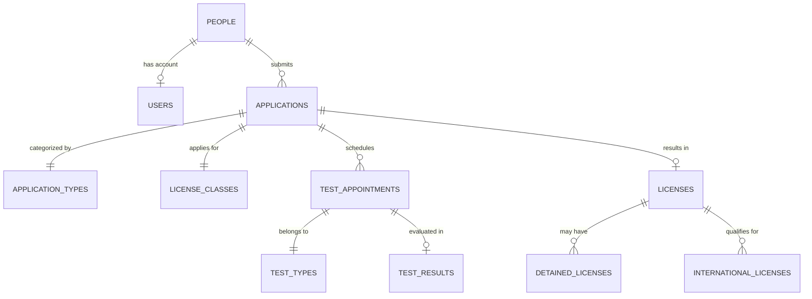

# Licentra Database Architecture & Future Roadmap

## Status: Implementation Postponed

> 📖 **Primary Technical Reference**: For system architecture and security governance, refer to [**Master Architecture Blueprint (docs/ARCHITECTURE.md)**](../docs/ARCHITECTURE.md) and [**Authoritative API Contracts (docs/api-contracts.md)**](../docs/api-contracts.md).

As agreed in the initial project requirements, the real PostgreSQL database connection (via Supabase) is **postponed** for this initial setup phase. Development and frontend-backend integration will proceed using the **Repository Pattern** with mock data stored in each member's backend repository module.

### Architectural Status Legend

| Status Label | Meaning & Scope in Licentra |
| :--- | :--- |
| **Implemented and tested** | Backend routes, controllers, services, repositories, and middleware exist, run against mock data, and pass all automated test assertions in `backend/test-api.js` (172 passing). |
| **Implemented but not adequately tested** | Code exists and executes (e.g., layouts, API client, graceful shutdown), but lacks automated unit or integration tests. |
| **Scaffolded or placeholder only** | Components and routes exist and mount cleanly, but render placeholder UI (`PlaceholderPage`). |
| **Planned** | Architected and documented; scheduled for future development phases. |
| **Postponed** | Deliberately deferred to Phase 2 to prevent early database or infrastructure blockers. |

---

## 1. Why the Repository Pattern?

To enable seamless transition from mock data to PostgreSQL / Supabase without breaking API contracts or controller logic, we use the **Repository Pattern**:

```
[ Frontend React App ]
         │ (HTTP / JSON)
         ▼
[ Express Router ] ──────> [ Controller ] ──────> [ Service ] ──────> [ Repository ]
                                                                             │
                                              ┌──────────────────────────────┴──────────────────────────────┐
                                              │                                                             │
                                     [ Phase 1: Mock Data ]                              [ Phase 2: PostgreSQL / Supabase ]
                                  (In-memory JS collections)                              (pg pool / @supabase/supabase-js)
```

- **Feature Controllers & Services** depend only on the public contract methods of each repository (e.g., `findAll()`, `findById()`, `create()`, `update()`, `delete()`).
- In Phase 2, swapping from in-memory mock collections to real database queries will take place **primarily within the repository layer** for standard CRUD operations. However, migrating to a relational database has multi-layer architectural impacts that must be coordinated:
  1. **Schema & Data Model Evolution**: Column renames, UUID vs serial ID mappings, new mandatory fields, or relational foreign keys may require updates to service-layer payload validation and DTO response mapping.
  2. **Relational Error Handling**: Real database operations introduce asynchronous error states (e.g., unique key violation `23505`, foreign key constraint failure `23503`, connection pool timeouts) that must be caught and normalized into standard API error envelopes.
  3. **Atomic Transactions**: Workflows affecting multiple tables (such as impounding a license and generating a detention fine, or filing an application) require transactional guarantees (`BEGIN` / `COMMIT` / `ROLLBACK`) managed in the data access layer.

---

## 2. Planned Target Schema (PostgreSQL)

When ready, Licentra will be backed by a relational PostgreSQL schema deployed on Supabase, designed for high referential integrity, auditability, and role-based access control.

### Core Entities & Relationships



### Table Definitions Overview

1. **`people`**
   - Stores personal civilian records (National No, First/Second/Third/LastName, DateOfBirth, Gender, Address, Phone, Email, NationalityCountryID, ImagePath).
2. **`users`**
   - System users (Employees, Admins, Citizens) linked to a `PersonID`, with password hashes and `Role` (`Admin`, `Officer`, `Citizen`).
3. **`application_types`**
   - Types of applications: New Local License, Renew License, Replacement for Lost, Replacement for Damaged, Release Detained, New International License. Includes default fees.
4. **`license_classes`**
   - The 7 vehicle license categories: Class 1 (Light Motorcycle), Class 2 (Heavy Motorcycle), Class 3 (Private Vehicle), Class 4 (Taxi / Limousine), Class 5 (Agricultural), Class 6 (Bus), Class 7 (Heavy Vehicle). Specifies minimum age, validity years, and standard fees.
5. **`applications`**
   - Lifecycle tracking: `ApplicationID`, `ApplicantPersonID`, `ApplicationDate`, `ApplicationTypeID`, `ApplicationStatus` (`New`, `Cancelled`, `Completed`), `LastStatusDate`, `PaidFees`, `CreatedByUserID`.
6. **`licenses`**
   - Issued driving licenses: `LicenseID`, `ApplicationID`, `DriverID`, `LicenseClassID`, `IssueDate`, `ExpirationDate`, `Notes`, `PaidFees`, `IsActive`, `IssueReason`.
7. **`test_types`**
   - Vision Test, Theory Test, Practical Street Test.
8. **`test_appointments` & `tests`**
   - Test scheduling, fees, lock status, and examiner results (`Pass` / `Fail`, test notes).
9. **`detained_licenses`**
   - Record of traffic police license holds, fine amounts, release dates, and release application links.

---

## 3. Migration & Version Control Workflow (Future Phase)

When database implementation starts:
1. **Never apply manual migrations directly through the Supabase GUI in production.**
2. All database DDL changes will be tracked as version-controlled SQL files inside:
   ```
   database/
   ├── migrations/
   │   ├── 001_initial_schema.sql
   │   ├── 002_seed_initial_data.sql
   │   └── ...
   ```
3. Use the Supabase CLI (`supabase db diff`, `supabase migration up`) or standard PostgreSQL migration runners (`node-pg-migrate` / Prisma) to guarantee reproducibility across development, staging, and production.
4. Database connection strings will remain in `.env` and `.env.example` under `DATABASE_URL` and `SUPABASE_URL` with zero secrets committed to Git.

---

## 4. Cross-References & Documentation Links

- [**Master Architecture Blueprint (`docs/ARCHITECTURE.md`)**](../docs/ARCHITECTURE.md) — Comprehensive technical specification, folder tree, and security governance.
- [**Authoritative API Contracts (`docs/api-contracts.md`)**](../docs/api-contracts.md) — REST endpoints, request payloads, response envelopes, and HTTP status codes.
- [**Git & Monorepo Merge Workflow (`docs/merge-workflow.md`)**](../docs/merge-workflow.md) — Branch conventions, PR standards, and conflict management.
- [**Project Overview & Quick Start (`README.md`)**](../README.md) — Monorepo setup, execution commands, and security warning.

