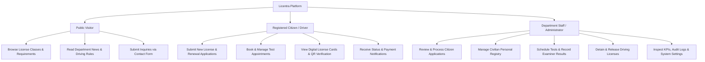
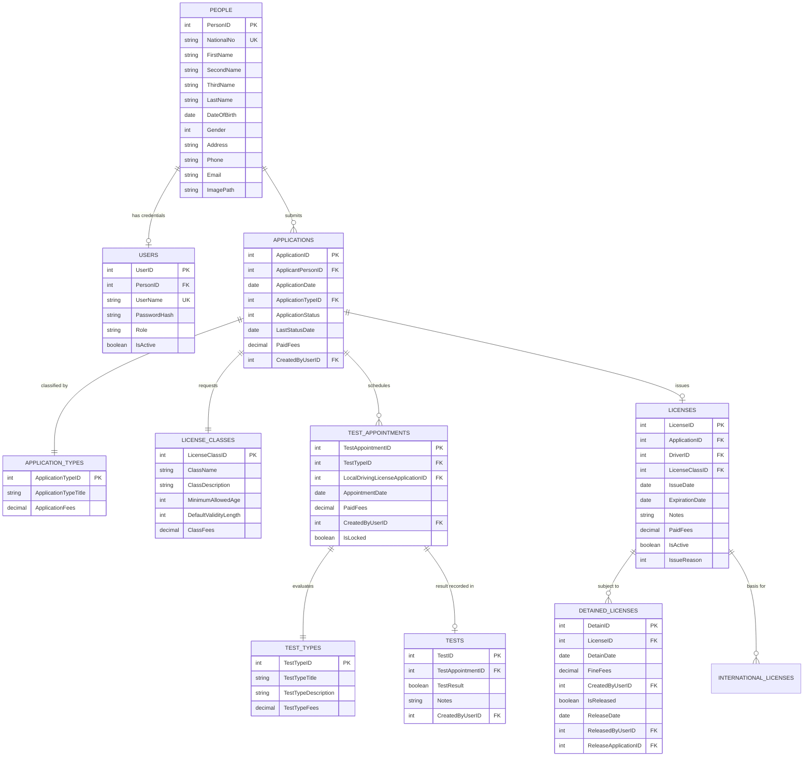

# Licentra — Complete Technical Architecture & System Blueprint

> **System Status**: Active Development (Phase 1: Architecture & Scaffolding Complete)  
> **Target Audience**: Software Engineers, Technical Leads, Architects, and AI Agents  
> **Document Role**: Single Source of Truth (SSOT) for the Licentra Full-Stack Platform  
> **Primary Repository**: Monorepo (`Licentra`)  

---

## Table of Contents

1. [Executive Overview & Objectives](#1-executive-overview--objectives)
2. [The 19 Official Pages Specification](#2-the-19-official-pages-specification)
3. [Technology Stack & System Architecture](#3-technology-stack--system-architecture)
4. [Complete Directory & Folder Tree](#4-complete-directory--folder-tree)
5. [Team Structure & Member Ownership](#5-team-structure--member-ownership)
6. [Frontend Architecture & Implementation](#6-frontend-architecture--implementation)
7. [Backend Architecture & REST API Design](#7-backend-architecture--rest-api-design)
8. [Database Architecture & Future Integration](#8-database-architecture--future-integration)
9. [Git Workflow & Collaboration Model](#9-git-workflow--collaboration-model)
10. [Installation, Configuration & Execution Guide](#10-installation-configuration--execution-guide)
11. [API Contracts & Data Flow Specifications](#11-api-contracts--data-flow-specifications)
12. [Security, Governance & Engineering Guidelines](#12-security-governance--engineering-guidelines)
13. [Current Implementation Status & Future Roadmap](#13-current-implementation-status--future-roadmap)
14. [Architectural Verification & Evidence Checklist](#14-architectural-verification--evidence-checklist)

---

## 1. Executive Overview & Objectives

### 1.1 Project Identity
- **Project Name**: Licentra
- **Sub-Title / Domain**: Driving & Vehicle License Department (DVLD) Management System
- **Repository Strategy**: Unified Monorepo housing the frontend SPA, backend REST API, database documentation, and technical specifications.

### 1.2 Core Mission & Objectives
Licentra is an enterprise-grade digital public service portal engineered to streamline, digitize, and automate the end-to-end lifecycle of driver licensing and traffic department administration. The primary goals include:

1. **Eliminating Bureaucratic Friction**: Providing citizens with a self-service portal to submit license applications, book tests, renew credentials, and track review milestones in real time.
2. **Standardizing Testing & Examination**: Centralizing appointment scheduling and examiner scoring across the three mandatory testing phases (Vision, Theory/Knowledge, and Practical Road Driving).
3. **Transparent Traffic Enforcement**: Giving traffic officers and administrators unified tools to issue licenses, manage suspensions/holds (detentions), collect statutory fees, and settle violations.
4. **Resilient Collaborative Engineering**: Facilitating concurrent development across a **7-member engineering team** using a feature-based folder isolation model to minimize cross-member code collisions.

### 1.3 Target Personas & System Roles
The system accommodates three distinct user archetypes:



### 1.4 Main System Areas
The application is logically segmented into three distinct functional areas comprising **19 official pages**:

1. **Public Website (7 Pages)**: Informational portal accessible to all unauthenticated citizens, providing service catalogs, licensing rules, test guides, and inquiry forms.
2. **Admin Dashboard (6 Pages)**: High-security back-office operations console for department officers, examiners, and system administrators.
3. **User Portal (6 Pages)**: Authenticated self-service hub where citizens manage personal documents, submit applications, schedule exams, and inspect digital credentials.

### 1.5 Current Development Stage
- **Phase 1: Architecture, Scaffolding, Routing & Mock REST API (Current State)**:
  - Monorepo structure and tooling initialized.
  - All 19 pages registered in React Router with layout shells. **All 19 frontend page components are currently `PlaceholderPage` scaffolds** — real UI implementation is the next step for each member.
  - Express.js backend operational with 11 isolated feature modules (routes, controllers, services, mock repositories).
  - In-memory mock repositories implementing the **Repository Pattern** — 32 API endpoints tested and passing.
  - PostgreSQL / Supabase connection purposefully **postponed** to decouple feature development from database setup.
- **Phase 2: UI Implementation, Database Persistence & Auth (Planned Next)**:
  - Each team member builds the real React UI for their assigned pages.
  - Real PostgreSQL database connection via Supabase.
  - JWT-based authentication, password hashing, and role-based access control (RBAC).
- **Phase 3: Production Hardening (Planned Future)**:
  - Real-time notifications (WebSockets/SSE), payment gateway integration, frontend automated test suites (Vitest), and containerized deployment.

---

## 2. The 19 Official Pages Specification

The Licentra system defines **exactly 19 official pages**. In accordance with core architectural guidelines, their English page names, designated routes, layout parents, and backend module associations are strictly maintained as follows:

### A. Public Website (7 Pages)
Layout Parent: `PublicLayout` (`frontend/src/layouts/PublicLayout.jsx`)

| # | Official English Page Name | Frontend Route | Owner | Frontend Component Path | Backend API Route | Status |
|---|---|---|---|---|---|---|
| 1 | **Home** | `/` | Member 1 | `frontend/src/members/member-1/home/HomePage.jsx` | Aggregate (`/api/services`, `/api/license-classes`, `/api/news`) | Scaffolded / Mock Badges Active |
| 2 | **About** | `/about` | Member 1 | `frontend/src/members/member-1/about/AboutPage.jsx` | Static / Health (`/api/health`) | Scaffolded / Mock Badges Active |
| 3 | **Services** | `/services` | Member 2 | `frontend/src/members/member-2/services/ServicesPage.jsx` | `/api/services` (GET `/`, GET `/:id`) | Scaffolded / Backend Implemented |
| 4 | **License Classes** | `/license-classes` | Member 2 | `frontend/src/members/member-2/license-classes/LicenseClassesPage.jsx` | `/api/license-classes` (GET `/`, GET `/:id`) | Scaffolded / Backend Implemented |
| 5 | **Driving Tests** | `/driving-tests` | Member 2 | `frontend/src/members/member-2/driving-tests/DrivingTestsPage.jsx` | Static Guide / Service Link (`/api/services/srv-001`) | Scaffolded / Guide Active |
| 6 | **News** | `/news` | Member 2 | `frontend/src/members/member-2/news/NewsPage.jsx` | `/api/news` (GET `/`, GET `/:id`) | Scaffolded / Backend Implemented |
| 7 | **Contact** | `/contact` | Member 1 | `frontend/src/members/member-1/contact/ContactPage.jsx` | `/api/contact` (GET `/`, POST `/`) | Scaffolded / Backend Implemented |

### B. Admin Dashboard (6 Pages)
Layout Parent: `AdminLayout` (`frontend/src/layouts/AdminLayout.jsx`)

| # | Official English Page Name | Frontend Route | Owner | Frontend Component Path | Backend API Route | Status |
|---|---|---|---|---|---|---|
| 8 | **Overview & Statistics** | `/admin` | Member 3 | `frontend/src/members/member-3/overview/OverviewPage.jsx` | `/api/admin/analytics/overview` (GET) | Scaffolded / Backend Implemented |
| 9 | **People Management** | `/admin/people` | Member 4 | `frontend/src/members/member-4/people-management/PeopleManagementPage.jsx` | `/api/admin/people` (GET `/`, GET `/:id`, POST `/`) | Scaffolded / Backend Implemented |
| 10 | **Applications Management** | `/admin/applications` | Member 4 | `frontend/src/members/member-4/applications-management/ApplicationsManagementPage.jsx` | `/api/admin/applications` (GET `/`, GET `/:id`, PATCH `/:id/status`) | Scaffolded / Backend Implemented |
| 11 | **License Management** | `/admin/licenses` | Member 5 | `frontend/src/members/member-5/license-management/LicenseManagementPage.jsx` | `/api/admin/licenses` (GET `/`, GET `/:id`, POST `/:id/detain`) | Scaffolded / Backend Implemented |
| 12 | **Tests & Appointments** | `/admin/tests-appointments` | Member 5 | `frontend/src/members/member-5/tests-appointments/TestsAppointmentsPage.jsx` | `/api/admin/tests` (GET `/appointments`, POST `/appointments/:id/result`) | Scaffolded / Backend Implemented |
| 13 | **Reports & Settings** | `/admin/reports-settings` | Member 3 | `frontend/src/members/member-3/reports-settings/ReportsSettingsPage.jsx` | `/api/admin/settings` (GET `/`, PUT `/`) | Scaffolded / Backend Implemented |

### C. User Portal (6 Pages)
Layout Parent: `UserLayout` (`frontend/src/layouts/UserLayout.jsx`)  
*Note: Navigating to `/portal` triggers an automatic redirect to `/portal/profile`.*

| # | Official English Page Name | Frontend Route | Owner | Frontend Component Path | Backend API Route | Status |
|---|---|---|---|---|---|---|
| 14 | **My Profile** | `/portal/profile` | Member 6 | `frontend/src/members/member-6/my-profile/MyProfilePage.jsx` | `/api/portal/profile` (GET `/me`, PUT `/me`) | Scaffolded / Backend Implemented |
| 15 | **Submit Application** | `/portal/submit-application` | Member 6 | `frontend/src/members/member-6/submit-application/SubmitApplicationPage.jsx` | `/api/portal/applications` (POST `/submit`) | Scaffolded / Backend Implemented |
| 16 | **My Applications** | `/portal/my-applications` | Member 6 | `frontend/src/members/member-6/my-applications/MyApplicationsPage.jsx` | `/api/portal/applications` (GET `/my-applications`) | Scaffolded / Backend Implemented |
| 17 | **Appointments** | `/portal/appointments` | Member 7 | `frontend/src/members/member-7/appointments/AppointmentsPage.jsx` | `/api/portal/appointments` (GET `/my-appointments`, POST `/book`) | Scaffolded / Backend Implemented |
| 18 | **My Licenses** | `/portal/my-licenses` | Member 7 | `frontend/src/members/member-7/my-licenses/MyLicensesPage.jsx` | `/api/portal/licenses` (GET `/my-licenses`) | Scaffolded / Backend Implemented |
| 19 | **Notifications** | `/portal/notifications` | Member 7 | `frontend/src/members/member-7/notifications/NotificationsPage.jsx` | `/api/portal/notifications` (GET `/`, PATCH `/:id/read`) | Scaffolded / Backend Implemented |

---

## 3. Technology Stack & System Architecture

### 3.1 Technology Stack Summary

| Dimension | Selected Technology | Verified Version | Architectural Rationale |
|---|---|---|---|
| **Frontend Framework** | React.js | `^18.3.1` | Component-driven declarative UI, virtual DOM diffing, and ecosystem stability. |
| **Frontend Tooling** | Vite | `^6.0.1` | Instant Hot Module Replacement (HMR) and optimized Rollup-based production builds. |
| **Client Routing** | React Router DOM | `^6.28.0` | Declarative nested layout routing via `createBrowserRouter`. |
| **Frontend Styling** | Vanilla CSS + Design Tokens | Custom | CSS variables for consistent theming without third-party utility library lock-in. |
| **API Communication** | Native `fetch` Wrapper | Custom (`apiClient.js`) | Lightweight, centralized client handling base URLs and error normalization. |
| **Backend Runtime** | Node.js (ES Modules) | `v18+` / `v20+` | Native support for `import`/`export` (`"type": "module"`), non-blocking asynchronous I/O. |
| **Web Framework** | Express.js | `^4.21.2` | Minimalist HTTP middleware pipeline with established REST routing conventions. |
| **CORS Middleware** | cors | `^2.8.5` | Cross-Origin Resource Sharing handling for dev and production clients. |
| **Environment Config** | dotenv | `^16.4.7` | Centralized loading of environment variables into `process.env`. |
| **Backend Hot Reload** | nodemon | `^3.1.9` | Automatic server restarting during backend development. |
| **Process Orchestration** | concurrently | `^8.2.2` | Single-command root execution of both frontend and backend processes. |
| **Database (Planned)** | Supabase PostgreSQL | Phase 2 | Relational integrity, ACID compliance, SQL migrations, and row-level security. |
| **Current Data Layer** | In-Memory Collections | Phase 1 (Active) | Decoupled **Repository Pattern** serving mock collections during initial development. |

### 3.2 Architectural Pattern: The Repository Pattern
To decouple API endpoint logic from the physical database engine, Licentra mandates the **Repository Pattern** across all backend modules.

```
┌────────────────────────────────────────────────────────────────────────────────────────┐
│                                   CLIENT TIER (React)                                  │
│  React Components  ──>  apiClient.js (Fetch)  ──>  HTTP REST Request (JSON)            │
└──────────────────────────────────────────┬─────────────────────────────────────────────┘
                                           │
┌──────────────────────────────────────────▼─────────────────────────────────────────────┐
│                                   SERVER TIER (Express)                                │
│                                                                                        │
│  1. Express Router (e.g., /api/services)                                                │
│        │                                                                               │
│  2. Controller (Request validation, status code resolution, envelope dispatch)         │
│        │                                                                               │
│  3. Service Layer (Business rules, validations, orchestration)                         │
│        │                                                                               │
│  4. Repository Layer (Data abstraction contract: findAll, findById, create, update)    │
│        │                                                                               │
│        ├──────────────────────────────────────────┬────────────────────────────────────┤
│        │ [PHASE 1: ACTIVE NOW]                   │ [PHASE 2: PLANNED ROADMAP]         │
│        ▼                                          ▼                                    │
│   In-Memory Mock JS Arrays                   PostgreSQL / Supabase Connection Pool     │
│   (Fast, zero-dependency, isolated)          (Relational SQL queries, ACID compliance) │
└────────────────────────────────────────────────────────────────────────────────────────┘
```

#### Why this architectural choice matters:
1. **Zero Database Blockers**: Frontend developers and backend developers can write, test, and integrate full CRUD lifecycles immediately without waiting for database provisioning or credentials.
2. **Structured Future Migration Path**: When Supabase is integrated in Phase 2, query logic is isolated primarily within the repository layer. However, schema constraints, relational error handling, and potential field mapping changes must also be coordinated across service validation layers.

---

## 4. Complete Directory & Folder Tree

Below is the verified directory structure of the Licentra repository (excluding `node_modules` and build caches):

```text
Licentra/
├── .env.example                               # Root reference environment configuration
├── .gitignore                                 # Git ignore rules for node_modules, dist, .env
├── package.json                               # Root monorepo orchestration & concurrently scripts
├── package-lock.json                          # Root dependency lockfile
├── README.md                                  # Top-level repository overview and quickstart
│
├── database/                                  # Database architecture & migration assets
│   └── README.md                              # Target PostgreSQL schema, ERD, and migration plan
│
├── docs/                                      # System technical documentation
│   ├── ARCHITECTURE.md                        # Master Technical Architecture Blueprint (This document)
│   ├── api-contracts.md                       # REST API conventions and standard response envelopes
│   └── merge-workflow.md                      # Team Git branching, PR, and conflict-resolution rules
│
├── frontend/                                  # React 18 + Vite Single-Page Application (SPA)
│   ├── .env.example                           # Frontend environment variables example
│   ├── index.html                             # Single HTML entry point for Vite
│   ├── package.json                           # Frontend package manifest & scripts
│   ├── package-lock.json                      # Frontend dependency lockfile
│   ├── vite.config.js                         # Vite build and plugin configuration
│   └── src/
│       ├── main.jsx                           # React DOM mount point (ReactDOM.createRoot)
│       ├── index.css                          # Global design system tokens and base styles
│       ├── app/
│       │   ├── App.jsx                        # Root React component providing the RouterProvider
│       │   └── router.jsx                     # Central React Router v6 definitions (19 pages)
│       ├── layouts/
│       │   ├── AdminLayout.jsx                # Layout wrapper for the 6 Admin pages
│       │   ├── Layouts.css                    # Structural styling for navbar, sidebar, and footer
│       │   ├── PublicLayout.jsx               # Layout wrapper for the 7 Public pages
│       │   └── UserLayout.jsx                 # Layout wrapper for the 6 Citizen User Portal pages
│       ├── shared/
│       │   ├── api/
│       │   │   └── apiClient.js               # Centralized fetch wrapper (VITE_API_BASE_URL)
│       │   └── components/
│       │       └── PlaceholderPage.jsx        # Architecture-ready placeholder card component
│       └── members/                           # Isolated member feature folders
│           ├── member-1/                      # Public Core & Inquiries (Pages 1, 2, 7)
│           │   ├── about/AboutPage.jsx
│           │   ├── contact/ContactPage.jsx
│           │   └── home/HomePage.jsx
│           ├── member-2/                      # Public Catalog & Guides (Pages 3, 4, 5, 6)
│           │   ├── driving-tests/DrivingTestsPage.jsx
│           │   ├── license-classes/LicenseClassesPage.jsx
│           │   ├── news/NewsPage.jsx
│           │   └── services/ServicesPage.jsx
│           ├── member-3/                      # Admin Insights & Governance (Pages 8, 13)
│           │   ├── overview/OverviewPage.jsx
│           │   └── reports-settings/ReportsSettingsPage.jsx
│           ├── member-4/                      # Admin Operations: People & Applications (Pages 9, 10)
│           │   ├── applications-management/ApplicationsManagementPage.jsx
│           │   └── people-management/PeopleManagementPage.jsx
│           ├── member-5/                      # Admin Operations: Licenses & Tests (Pages 11, 12)
│           │   ├── license-management/LicenseManagementPage.jsx
│           │   └── tests-appointments/TestsAppointmentsPage.jsx
│           ├── member-6/                      # User Portal: Filing & Profile (Pages 14, 15, 16)
│           │   ├── my-applications/MyApplicationsPage.jsx
│           │   ├── my-profile/MyProfilePage.jsx
│           │   └── submit-application/SubmitApplicationPage.jsx
│           └── member-7/                      # User Portal: Activity & Records (Pages 17, 18, 19)
│               ├── appointments/AppointmentsPage.jsx
│               ├── my-licenses/MyLicensesPage.jsx
│               └── notifications/NotificationsPage.jsx
│
└── backend/                                   # Express.js REST API Server
    ├── .env.example                           # Backend environment variables example
    ├── package.json                           # Backend package manifest & scripts
    ├── package-lock.json                      # Backend dependency lockfile
    └── src/
        ├── server.js                          # HTTP server lifecycle entry point (port listening)
        ├── app.js                             # Express application factory & route registration
        ├── config/
        │   ├── database.js                    # DatabaseManager placeholder (mock vs future connection)
        │   └── env.js                         # Centralized environment variable loader & defaults
        ├── middleware/
        │   ├── errorHandler.js                # Centralized unhandled error formatting middleware
        │   ├── notFoundHandler.js             # 404 Not Found response middleware
        │   └── requestLogger.js               # Structured HTTP request timestamp & latency logger
        ├── shared/
        │   ├── constants/
        │   │   └── httpStatus.js              # Standard HTTP status code enumerations
        │   └── utils/
        │       └── response.js                # JSON envelope helpers (sendSuccess, sendError)
        └── members/                           # Isolated member backend modules
            ├── member-1/
            │   └── contact/                   # Contact inquiry submission & retrieval
            │       ├── contact.controller.js
            │       ├── contact.repository.js
            │       ├── contact.routes.js
            │       └── contact.service.js
            ├── member-2/
            │   ├── license-classes/           # License class catalog
            │   │   ├── license-classes.controller.js
            │   │   ├── license-classes.repository.js
            │   │   ├── license-classes.routes.js
            │   │   └── license-classes.service.js
            │   ├── news/                      # Department news & updates
            │   │   ├── news.controller.js
            │   │   ├── news.repository.js
            │   │   ├── news.routes.js
            │   │   └── news.service.js
            │   └── services/                  # Driving licensing service catalog
            │       ├── services.controller.js
            │       ├── services.repository.js
            │       ├── services.routes.js
            │       └── services.service.js
            ├── member-3/
            │   ├── analytics/                 # Executive KPI overview metrics
            │   │   ├── analytics.controller.js
            │   │   ├── analytics.repository.js
            │   │   ├── analytics.routes.js
            │   │   └── analytics.service.js
            │   └── settings/                  # Global department & fee settings
            │       ├── settings.controller.js
            │       ├── settings.repository.js
            │       ├── settings.routes.js
            │       └── settings.service.js
            ├── member-4/
            │   ├── applications/              # Admin application review & status transitions
            │   │   ├── applications.controller.js
            │   │   ├── applications.repository.js
            │   │   ├── applications.routes.js
            │   │   └── applications.service.js
            │   └── people/                    # Citizen & driver personal registry
            │       ├── people.controller.js
            │       ├── people.repository.js
            │       ├── people.routes.js
            │       └── people.service.js
            ├── member-5/
            │   ├── licenses/                  # Admin license issuance & detention
            │   │   ├── licenses.controller.js
            │   │   ├── licenses.repository.js
            │   │   ├── licenses.routes.js
            │   │   └── licenses.service.js
            │   └── tests/                     # Admin test appointments & examiner results
            │       ├── tests.controller.js
            │       ├── tests.repository.js
            │       ├── tests.routes.js
            │       └── tests.service.js
            ├── member-6/
            │   ├── profile/                   # Citizen self-service profile
            │   │   ├── profile.controller.js
            │   │   ├── profile.repository.js
            │   │   ├── profile.routes.js
            │   │   └── profile.service.js
            │   └── submissions/               # Citizen application filing & tracking
            │       ├── submissions.controller.js
            │       ├── submissions.repository.js
            │       ├── submissions.routes.js
            │       └── submissions.service.js
            └── member-7/
                ├── appointments/              # Citizen test booking & calendar
                │   ├── appointments.controller.js
                │   ├── appointments.repository.js
                │   ├── appointments.routes.js
                │   └── appointments.service.js
                ├── licenses/                  # Citizen digital license viewer
                │   ├── licenses.controller.js
                │   ├── licenses.repository.js
                │   ├── licenses.routes.js
                │   └── licenses.service.js
                └── notifications/             # Citizen alert notifications
                    ├── notifications.controller.js
                    ├── notifications.repository.js
                    ├── notifications.routes.js
                    └── notifications.service.js
```

---

## 5. Team Structure & Member Ownership

The development workload is distributed across **seven dedicated team members** using a **complexity-weighted** model. Because 19 pages cannot be divided equally by 7, the distribution is calibrated by the *total engineering effort* of each assignment — accounting for pages, backend modules, API endpoint count, frontend UI complexity, and cross-cutting dependencies — rather than raw page count alone.

```mermaid
graph LR
    subgraph Member1["Member 1: Public Core (3 pages, 1 module, 2 endpoints)"]
        M1_F[Home, About, Contact]
        M1_B[/api/contact]
    end

    subgraph Member2["Member 2: Public Catalog (4 pages, 3 modules, 6 endpoints)"]
        M2_F["Services, License Classes, Driving Tests*, News"]
        M2_B[/api/services, /api/license-classes, /api/news]
    end

    subgraph Member3["Member 3: Admin Insights (2 pages, 2 modules, 3 endpoints)"]
        M3_F[Overview & Stats, Reports & Settings]
        M3_B[/api/admin/analytics, /api/admin/settings]
    end

    subgraph Member4["Member 4: Admin Operations (2 pages, 2 modules, 6 endpoints)"]
        M4_F[People Mgmt, Applications Mgmt]
        M4_B[/api/admin/people, /api/admin/applications]
    end

    subgraph Member5["Member 5: Admin Licensing (2 pages, 2 modules, 5 endpoints)"]
        M5_F[License Mgmt, Tests & Appointments]
        M5_B[/api/admin/licenses, /api/admin/tests]
    end

    subgraph Member6["Member 6: Portal Filing (3 pages, 2 modules, 4 endpoints)"]
        M6_F[My Profile, Submit Application, My Applications]
        M6_B[/api/portal/profile, /api/portal/applications]
    end

    subgraph Member7["Member 7: Portal Records (3 pages, 3 modules, 5 endpoints)"]
        M7_F[Appointments, My Licenses, Notifications]
        M7_B[/api/portal/appointments, /api/portal/licenses, /api/portal/notifications]
    end
```

> \* Member 2's `Driving Tests` page is a **frontend-only** public educational guide with no dedicated backend CRUD module. Its absence of a backend module balances Member 2's higher page count.

---

### 5.1 Complexity-Weighted Workload Assessment

The following table is the **authoritative complexity analysis** used to validate the fairness of the workload distribution. It was produced by inspecting every page component, every backend module, every repository method, and every API endpoint in the codebase.

| Member | Domain | Pages | Backend Modules | API Endpoints | Frontend Complexity Notes | Backend Complexity Notes | Complexity Weight |
|:---|:---|:---:|:---:|:---:|:---|:---|:---:|
| **Member 1** | Public Core & Inquiries | 3 | 1 | 2 | Home is a high-impact landing page that aggregates data from 3 external APIs (Member 2's services, license-classes, news). About is static. Contact requires a validated form. | 1 module (`contact`): POST validation, inquiry storage — simple CRUD. | **Medium** |
| **Member 2** | Public Catalog & Guides | 4 | 3 | 6 | Services: filterable grid. License Classes: 7-category reference table. News: article feed. `Driving Tests`: **frontend-only guide** — NO dedicated backend module (offsets the extra page). | 3 modules (`services`, `license-classes`, `news`): read-only catalogs, `findAll`/`findById` pattern. 6 total GET endpoints. | **Medium-High** |
| **Member 3** | Admin Insights & Governance | 2 | 2 | 3 | Overview: KPI dashboard requiring chart integration (Chart.js / Recharts). Reports & Settings: admin configuration form with live PUT updates. | 2 modules (`analytics`, `settings`): analytics aggregates multi-KPI metrics objects; settings requires GET+PUT with field validation. | **Medium-High** |
| **Member 4** | Admin Operations: People & Apps | 2 | 2 | 6 | People Mgmt: paginated searchable data table + registration modal. Applications Mgmt: searchable list with multi-status workflow transitions. | 2 modules (`people`, `applications`): `findAll`/`findById`/`create` for people; `findAll`/`findById`/`updateStatus` for applications. Highest endpoint count (6). | **High** |
| **Member 5** | Admin Operations: Licenses & Tests | 2 | 2 | 5 | License Mgmt: table with detention/fine action modals. Tests & Appointments: schedule table with examiner result entry. | 2 modules (`licenses`, `tests`): license detention side-effects (`detainLicense`); test result recording with pass/fail state transitions. Domain logic is most complex in the admin area. | **High** |
| **Member 6** | Citizen Portal: Filing & Profile | 3 | 2 | 4 | My Profile: editable form with document display. **Submit Application: multi-step application wizard** (highest single-page frontend complexity in the project). My Applications: status tracking view. | 2 modules (`profile`, `submissions`): profile GET/PUT; submissions `findMyApplications`/`createApplication` with application number generation. | **High** |
| **Member 7** | Citizen Portal: Activity & Records | 3 | 3 | 5 | Appointments: citizen calendar with booking form. **My Licenses: digital ID card with QR verification** (high visual complexity). Notifications: alert feed with read/unread state. | 3 modules (`appointments`, `licenses`, `notifications`): most backend modules for any portal member. Appointments require booking logic; notifications require mark-as-read mutation. | **High** |

**Distribution Verdict**: The assignment is **fair and complexity-balanced**. Members with fewer pages (3, 4, 5) carry proportionally more backend endpoint complexity and harder UI features. Members with more pages (1, 2, 6, 7) have lighter-weight individual pages or reduced backend scope to compensate. No page ownership changes are required.

---

### 5.2 19-Page Primary Ownership Validation

All 19 official pages appear **exactly once** in the primary ownership table below. No page is shared or duplicated.

| # | Official Page Name | Route | Primary Owner | System Area |
|:---:|:---|:---|:---:|:---:|
| 1 | **Home** | `/` | Member 1 | Public |
| 2 | **About** | `/about` | Member 1 | Public |
| 3 | **Contact** | `/contact` | Member 1 | Public |
| 4 | **Services** | `/services` | Member 2 | Public |
| 5 | **License Classes** | `/license-classes` | Member 2 | Public |
| 6 | **Driving Tests** | `/driving-tests` | Member 2 | Public |
| 7 | **News** | `/news` | Member 2 | Public |
| 8 | **Overview & Statistics** | `/admin` | Member 3 | Admin |
| 9 | **Reports & Settings** | `/admin/reports-settings` | Member 3 | Admin |
| 10 | **People Management** | `/admin/people` | Member 4 | Admin |
| 11 | **Applications Management** | `/admin/applications` | Member 4 | Admin |
| 12 | **License Management** | `/admin/licenses` | Member 5 | Admin |
| 13 | **Tests & Appointments** | `/admin/tests-appointments` | Member 5 | Admin |
| 14 | **My Profile** | `/portal/profile` | Member 6 | Portal |
| 15 | **Submit Application** | `/portal/submit-application` | Member 6 | Portal |
| 16 | **My Applications** | `/portal/my-applications` | Member 6 | Portal |
| 17 | **Appointments** | `/portal/appointments` | Member 7 | Portal |
| 18 | **My Licenses** | `/portal/my-licenses` | Member 7 | Portal |
| 19 | **Notifications** | `/portal/notifications` | Member 7 | Portal |

✅ **19/19 pages accounted for. Each page appears exactly once.**

---

### 5.3 Member Responsibility Matrix

#### Member 1: Public Core & Inquiries
- **Focus Domain**: Public website entry point, brand landing page, and citizen inquiry channel.
- **Assigned Frontend Pages** (3):
  1. `Home` (`/`) → `frontend/src/members/member-1/home/HomePage.jsx`
  2. `About` (`/about`) → `frontend/src/members/member-1/about/AboutPage.jsx`
  3. `Contact` (`/contact`) → `frontend/src/members/member-1/contact/ContactPage.jsx`
- **Assigned Backend Module** (1): `backend/src/members/member-1/contact/`
- **Owned API Routes** (2 endpoints):
  - `GET /api/contact` — Retrieve submitted public inquiry messages
  - `POST /api/contact` — Submit a new public support inquiry
- **Complexity Notes**:
  - `Home` is the most visited public page; requires consuming data from 3 of Member 2's APIs and building a full hero + shortcuts UI.
  - `About` is a static informational page.
  - `Contact` requires a validated multi-field submission form on the frontend.
  - Backend scope is intentionally narrow (1 module, 2 endpoints) to balance the heavier frontend UI expectations of the Home page.
- **Shared Data Dependencies**: `HomePage` aggregates live data from `/api/services`, `/api/license-classes`, and `/api/news` (owned by Member 2).

#### Member 2: Public Catalog, Classes & News
- **Focus Domain**: Public-facing reference content — service catalog, license class guide, test guide, and news feed.
- **Assigned Frontend Pages** (4):
  1. `Services` (`/services`) → `frontend/src/members/member-2/services/ServicesPage.jsx`
  2. `License Classes` (`/license-classes`) → `frontend/src/members/member-2/license-classes/LicenseClassesPage.jsx`
  3. `Driving Tests` (`/driving-tests`) → `frontend/src/members/member-2/driving-tests/DrivingTestsPage.jsx`
  4. `News` (`/news`) → `frontend/src/members/member-2/news/NewsPage.jsx`
- **Assigned Backend Modules** (3):
  - `backend/src/members/member-2/services/`
  - `backend/src/members/member-2/license-classes/`
  - `backend/src/members/member-2/news/`
- **Owned API Routes** (6 endpoints):
  - `GET /api/services`, `GET /api/services/:id`
  - `GET /api/license-classes`, `GET /api/license-classes/:id`
  - `GET /api/news`, `GET /api/news/:id`
- **Complexity Notes**:
  - Member 2 owns the highest page count (4) but the `Driving Tests` page carries **zero backend responsibility** — it is a pure frontend educational guide page that links to Member 5's admin test endpoints and Member 7's citizen booking endpoints.
  - The 3 backend modules are all read-only catalog patterns (`findAll`/`findById`), which is lower complexity per module than the write-heavy modules of Members 4 and 5.
  - The extra page count (4 vs. the common 2–3) is the intentional workload balancer for this member.
- **Data Provider Role**: Member 2's APIs are consumed by Member 1's `HomePage` as shared data dependencies.

#### Member 3: Admin Insights, Governance & Settings
- **Focus Domain**: Executive analytics dashboard and system-wide configuration management.
- **Assigned Frontend Pages** (2):
  1. `Overview & Statistics` (`/admin`) → `frontend/src/members/member-3/overview/OverviewPage.jsx`
  2. `Reports & Settings` (`/admin/reports-settings`) → `frontend/src/members/member-3/reports-settings/ReportsSettingsPage.jsx`
- **Assigned Backend Modules** (2):
  - `backend/src/members/member-3/analytics/`
  - `backend/src/members/member-3/settings/`
- **Owned API Routes** (3 endpoints):
  - `GET /api/admin/analytics/overview` — Executive KPI metrics & class distribution summary
  - `GET /api/admin/settings` — Retrieve system fee schedule and operational rules
  - `PUT /api/admin/settings` — Update global department parameters
- **Complexity Notes**:
  - Lower page count (2) is offset by high frontend UI complexity: the Overview page requires integrating a charting library (Chart.js or Recharts) for KPI visualizations and trend indicators.
  - The Reports & Settings page requires a live-editable configuration form with real-time feedback.
  - The analytics backend module aggregates multi-KPI metric objects that will grow significantly in Phase 2.

#### Member 4: Admin Operations (People & Applications)
- **Focus Domain**: Core administrative data management — citizen registry and application lifecycle.
- **Assigned Frontend Pages** (2):
  1. `People Management` (`/admin/people`) → `frontend/src/members/member-4/people-management/PeopleManagementPage.jsx`
  2. `Applications Management` (`/admin/applications`) → `frontend/src/members/member-4/applications-management/ApplicationsManagementPage.jsx`
- **Assigned Backend Modules** (2):
  - `backend/src/members/member-4/people/`
  - `backend/src/members/member-4/applications/`
- **Owned API Routes** (6 endpoints — joint highest in the project):
  - `GET /api/admin/people`, `GET /api/admin/people/:id`, `POST /api/admin/people`
  - `GET /api/admin/applications`, `GET /api/admin/applications/:id`, `PATCH /api/admin/applications/:id/status`
- **Complexity Notes**:
  - Highest endpoint count (6) in the project alongside the complexity of multi-status application workflow transitions (`Pending`, `Under Review`, `Approved`, `Rejected`).
  - People Management requires a searchable, paginated data table with a registration modal form and National ID validation logic.
  - Applications Management requires cross-referencing citizen records and supporting admin review actions.

#### Member 5: Admin Operations (Licenses & Tests)
- **Focus Domain**: License issuance, detention enforcement, and examination scheduling.
- **Assigned Frontend Pages** (2):
  1. `License Management` (`/admin/licenses`) → `frontend/src/members/member-5/license-management/LicenseManagementPage.jsx`
  2. `Tests & Appointments` (`/admin/tests-appointments`) → `frontend/src/members/member-5/tests-appointments/TestsAppointmentsPage.jsx`
- **Assigned Backend Modules** (2):
  - `backend/src/members/member-5/licenses/`
  - `backend/src/members/member-5/tests/`
- **Owned API Routes** (5 endpoints):
  - `GET /api/admin/licenses`, `GET /api/admin/licenses/:id`, `POST /api/admin/licenses/:id/detain`
  - `GET /api/admin/tests/appointments`, `POST /api/admin/tests/appointments/:id/result`
- **Complexity Notes**:
  - `detainLicense` is the most domain-complex backend action in Phase 1: it involves a status side-effect (activating a fine, toggling `isDetained`, deactivating the license record) — the deepest business rule in the mock repository layer.
  - Tests & Appointments requires building a schedule calendar view and an examiner result entry form.
  - License Management page requires a detention/release modal with fine amount entry.
  - The 2-page count is offset by the highest business-rule complexity across all admin modules.

#### Member 6: Citizen Portal (Filing & Profile)
- **Focus Domain**: Citizen self-service — identity management, license application filing, and application tracking.
- **Assigned Frontend Pages** (3):
  1. `My Profile` (`/portal/profile`) → `frontend/src/members/member-6/my-profile/MyProfilePage.jsx`
  2. `Submit Application` (`/portal/submit-application`) → `frontend/src/members/member-6/submit-application/SubmitApplicationPage.jsx`
  3. `My Applications` (`/portal/my-applications`) → `frontend/src/members/member-6/my-applications/MyApplicationsPage.jsx`
- **Assigned Backend Modules** (2):
  - `backend/src/members/member-6/profile/`
  - `backend/src/members/member-6/submissions/`
- **Owned API Routes** (4 endpoints):
  - `GET /api/portal/profile/me`, `PUT /api/portal/profile/me`
  - `GET /api/portal/applications/my-applications`, `POST /api/portal/applications/submit`
- **Complexity Notes**:
  - `Submit Application` is the **single highest-complexity page in the entire project** from a frontend perspective: it requires a multi-step wizard UI (service selection → document upload → review → payment), making it equivalent in effort to 2–3 standard pages.
  - The submissions repository implements application number auto-generation, fee calculation defaults, and sequential step tracking.
  - `My Applications` requires a status timeline visualization.

#### Member 7: Citizen Portal (Activity & Records)
- **Focus Domain**: Citizen test management, digital credential viewing, and notification management.
- **Assigned Frontend Pages** (3):
  1. `Appointments` (`/portal/appointments`) → `frontend/src/members/member-7/appointments/AppointmentsPage.jsx`
  2. `My Licenses` (`/portal/my-licenses`) → `frontend/src/members/member-7/my-licenses/MyLicensesPage.jsx`
  3. `Notifications` (`/portal/notifications`) → `frontend/src/members/member-7/notifications/NotificationsPage.jsx`
- **Assigned Backend Modules** (3 — highest backend module count for any portal member):
  - `backend/src/members/member-7/appointments/`
  - `backend/src/members/member-7/licenses/`
  - `backend/src/members/member-7/notifications/`
- **Owned API Routes** (5 endpoints):
  - `GET /api/portal/appointments/my-appointments`, `POST /api/portal/appointments/book`
  - `GET /api/portal/licenses/my-licenses`
  - `GET /api/portal/notifications`, `PATCH /api/portal/notifications/:id/read`
- **Complexity Notes**:
  - `My Licenses` requires a **digital ID card UI** with QR verification code rendering — the most visually complex single component in the portal.
  - `Appointments` requires a calendar-integrated booking form with test-type selection.
  - Member 7 owns 3 backend modules — the most of any citizen portal member — to compensate for pages that are individually less complex than Member 6's Submit Application wizard.
  - Notifications require `isRead` state mutation and unread-count badge propagation to the layout.

---

### 5.4 Central Shared Files & Coordination Governance
Certain files govern the entire monorepo and **must not be edited directly without peer coordination**:

1. `frontend/src/app/router.jsx`: Central routing table.
2. `backend/src/app.js`: Central Express app & route registration.
3. `backend/src/server.js`: Server lifecycle & port listening.
4. `frontend/src/layouts/*`: Shared Public, Admin, and User layouts and CSS.
5. `frontend/src/shared/api/apiClient.js`: Shared HTTP client.
6. `package.json` (Root, Frontend, Backend): Dependency declarations.
7. `backend/src/config/database.js`: Central database connection manager.

### 5.5 Step-by-Step: Adding or Expanding a Feature Safely
When any member develops their assigned page or adds a sub-component:
1. Work **only** within your designated directories (`frontend/src/members/member-X/` and `backend/src/members/member-X/`).
2. If adding a new sub-component or hook, place it inside your feature folder (e.g., `frontend/src/members/member-4/people-management/components/PersonModal.jsx`).
3. If new backend functionality is needed, create new methods inside your existing service and controller files.
4. Never edit another member's repository or service files.
5. Test locally using `npm run dev` before committing.

---

## 6. Frontend Architecture & Implementation

### 6.1 Application Entry & Mounting
- Entry Point: `frontend/src/main.jsx`
- Mounting Logic: Calls `ReactDOM.createRoot(document.getElementById('root'))` and wraps the root `<App />` component inside `<React.StrictMode>`.
- Global CSS: Imports `frontend/src/index.css` which establishes CSS variables, resets, and typography.
- Root Provider: `frontend/src/app/App.jsx` renders `<RouterProvider router={router} />`.

### 6.2 Router Configuration (`router.jsx`)
Routing is powered by React Router v6 using `createBrowserRouter`:

```jsx
// Excerpt from frontend/src/app/router.jsx
export const router = createBrowserRouter([
  // 1. Public Website Routes (7 pages)
  {
    path: '/',
    element: <PublicLayout />,
    children: [
      { index: true, element: <HomePage /> },
      { path: 'about', element: <AboutPage /> },
      { path: 'services', element: <ServicesPage /> },
      { path: 'license-classes', element: <LicenseClassesPage /> },
      { path: 'driving-tests', element: <DrivingTestsPage /> },
      { path: 'news', element: <NewsPage /> },
      { path: 'contact', element: <ContactPage /> },
    ],
  },
  // 2. Admin Dashboard Routes (6 pages)
  {
    path: '/admin',
    element: <AdminLayout />,
    children: [
      { index: true, element: <OverviewPage /> },
      { path: 'people', element: <PeopleManagementPage /> },
      { path: 'applications', element: <ApplicationsManagementPage /> },
      { path: 'licenses', element: <LicenseManagementPage /> },
      { path: 'tests-appointments', element: <TestsAppointmentsPage /> },
      { path: 'reports-settings', element: <ReportsSettingsPage /> },
    ],
  },
  // 3. User Portal Routes (6 pages)
  {
    path: '/portal',
    element: <UserLayout />,
    children: [
      { index: true, element: <Navigate to="/portal/profile" replace /> },
      { path: 'profile', element: <MyProfilePage /> },
      { path: 'submit-application', element: <SubmitApplicationPage /> },
      { path: 'my-applications', element: <MyApplicationsPage /> },
      { path: 'appointments', element: <AppointmentsPage /> },
      { path: 'my-licenses', element: <MyLicensesPage /> },
      { path: 'notifications', element: <NotificationsPage /> },
    ],
  },
  // Catch-all route
  { path: '*', element: <Navigate to="/" replace /> },
]);
```

### 6.3 Layout System
All 19 pages render inside one of three structural layout components:

1. **`PublicLayout` (`frontend/src/layouts/PublicLayout.jsx`)**:
   - Contains a top information bar with contact details and portal shortcuts.
   - Fixed header navbar with brand mark (`L Licentra`) and navigation links for Home, About, Services, License Classes, Driving Tests, News, and Contact.
   - Includes a primary call-to-action button: **"Apply Now →"** routing to `/portal/submit-application`.
   - Renders child routes via `<Outlet />`.
   - Comprehensive footer with quick links, portal links, and copyright statement.

2. **`AdminLayout` (`frontend/src/layouts/AdminLayout.jsx`)**:
   - Two-column dashboard shell: 260px dark sidebar (`#0F172A`) and fluid main content area.
   - Vertical sidebar navigation with active indicator styling (`#DC2626` background) for:
     - 📊 Overview & Statistics
     - 👥 People Management
     - 📄 Applications Management
     - 🪪 License Management
     - 📅 Tests & Appointments
     - ⚙️ Reports & Settings
   - Sidebar footer with direct return link to the public website (`/`).
   - Top operational console bar displaying current date and admin profile avatar.

3. **`UserLayout` (`frontend/src/layouts/UserLayout.jsx`)**:
   - Dedicated citizen portal shell with matching 260px dark sidebar.
   - Vertical citizen navigation links:
     - 👤 My Profile
     - 📝 Submit Application
     - 📑 My Applications
     - 📅 Appointments
     - 🪪 My Licenses
     - 🔔 Notifications
   - Topbar displaying active citizen profile name (`Noura Mohamed`) and account status badge.

### 6.4 Shared API Client (`apiClient.js`)
All frontend components communicate with backend endpoints via `frontend/src/shared/api/apiClient.js`:

```javascript
// Excerpt from frontend/src/shared/api/apiClient.js
const API_BASE_URL = import.meta.env.VITE_API_BASE_URL || 'http://localhost:5000/api';

export const apiClient = {
  baseUrl: API_BASE_URL,

  async request(endpoint, options = {}) {
    const url = `${this.baseUrl}${endpoint.startsWith('/') ? endpoint : `/${endpoint}`}`;
    const headers = { 'Content-Type': 'application/json', ...options.headers };

    const response = await fetch(url, { ...options, headers });
    const data = await response.json().catch(() => null);

    if (!response.ok) {
      const error = new Error(data?.error?.message || `HTTP error! status: ${response.status}`);
      error.status = response.status;
      error.data = data;
      throw error;
    }
    return data;
  },

  get(endpoint, options = {}) { return this.request(endpoint, { ...options, method: 'GET' }); },
  post(endpoint, body, options = {}) { return this.request(endpoint, { ...options, method: 'POST', body: JSON.stringify(body) }); },
  put(endpoint, body, options = {}) { return this.request(endpoint, { ...options, method: 'PUT', body: JSON.stringify(body) }); },
  patch(endpoint, body, options = {}) { return this.request(endpoint, { ...options, method: 'PATCH', body: JSON.stringify(body) }); },
  delete(endpoint, options = {}) { return this.request(endpoint, { ...options, method: 'DELETE' }); },
};
```

### 6.5 Vite Environment Variables
Vite exposes client-side environment variables prefixed with `VITE_`:
- `VITE_API_BASE_URL`: Full base path to the backend API (`http://localhost:5000/api`).
- `VITE_APP_NAME`: Application title used in page titles and navigation headers.

---

## 7. Backend Architecture & REST API Design

### 7.1 Server Lifecycle & Entry Points
1. `backend/src/server.js`:
   - Calls `await dbManager.connect()` to initialize the database manager (currently confirms mock repository mode).
   - Instantiates the Express application via `createApp()`.
   - Listens on `config.port` (default `5000`).
   - Hooks `SIGTERM` and `SIGINT` for graceful shutdown.
2. `backend/src/app.js`:
   - Factory function `createApp()` constructing and configuring the Express instance.
   - Registers CORS, `express.json()`, `express.urlencoded()`, and `requestLogger`.
   - Mounts `/api/health` system monitoring route.
   - Mounts all 11 member feature routers under explicit `/api/...` prefixes.
   - Mounts `notFoundHandler` (404) and `errorHandler` (500) at the end of the middleware stack.

### 7.2 Core Middleware Stack
- **`requestLogger` (`backend/src/middleware/requestLogger.js`)**:
  Intercepts every incoming request, measures execution duration via `res.on('finish')`, and outputs structured timestamp logs:
  `[2026-10-17T03:30:00.000Z] GET /api/admin/analytics/overview 200 - 4ms`
- **`notFoundHandler` (`backend/src/middleware/notFoundHandler.js`)**:
  Catches any request not matched by registered routes and returns HTTP 404 with standardized error envelope.
- **`errorHandler` (`backend/src/middleware/errorHandler.js`)**:
  Catches unhandled exceptions thrown anywhere in the controller/service pipeline, logs the stack trace to `console.error`, and formats an HTTP 500 (or custom status) JSON envelope.

### 7.3 Response Envelope Utilities (`response.js`)
All endpoints utilize standardized response helpers:
- `sendSuccess(res, data, message, statusCode, meta)`: Returns standard `{ success: true, data, message, meta }`.
- `sendError(res, message, statusCode, code, details, meta)`: Returns standard `{ success: false, error: { code, message, details }, meta }`.

### 7.4 Master API Reference Table
Below is the complete catalog of all backend REST endpoints currently implemented in the Licentra codebase:

| Method | Endpoint | Module | Purpose | Current Status |
|---|---|---|---|---|
| `GET` | `/api/health` | System | Health check, uptime, version, and database status | **Implemented** (Live) |
| `GET` | `/api/contact` | Member 1 (`contact`) | Retrieve submitted public inquiry messages | **Implemented** (Mock Data) |
| `POST` | `/api/contact` | Member 1 (`contact`) | Submit a new public support inquiry or ticket | **Implemented** (Mock Data) |
| `GET` | `/api/services` | Member 2 (`services`) | Retrieve all driving license service categories & fees | **Implemented** (Mock Data) |
| `GET` | `/api/services/:id` | Member 2 (`services`) | Retrieve detailed info for a single service (e.g., `srv-001`) | **Implemented** (Mock Data) |
| `GET` | `/api/license-classes` | Member 2 (`license-classes`) | Retrieve catalog of all 7 driving license categories | **Implemented** (Mock Data) |
| `GET` | `/api/license-classes/:id` | Member 2 (`license-classes`) | Retrieve license class details by ID | **Implemented** (Mock Data) |
| `GET` | `/api/news` | Member 2 (`news`) | Retrieve list of department news articles & announcements | **Implemented** (Mock Data) |
| `GET` | `/api/news/:id` | Member 2 (`news`) | Retrieve a single news article by ID | **Implemented** (Mock Data) |
| `GET` | `/api/admin/analytics/overview` | Member 3 (`analytics`) | Executive KPIs (pass rates, applications, active drivers) | **Implemented** (Mock Data) |
| `GET` | `/api/admin/settings` | Member 3 (`settings`) | Retrieve system configuration, fees, and lock hours | **Implemented** (Mock Data) |
| `PUT` | `/api/admin/settings` | Member 3 (`settings`) | Update global department parameters and fee amounts | **Implemented** (Mock Data) |
| `GET` | `/api/admin/people` | Member 4 (`people`) | List citizen records with National ID & contact data | **Implemented** (Mock Data) |
| `GET` | `/api/admin/people/:id` | Member 4 (`people`) | Retrieve single person by ID or National ID | **Implemented** (Mock Data) |
| `POST` | `/api/admin/people` | Member 4 (`people`) | Register a new person into the civilian registry | **Implemented** (Mock Data) |
| `GET` | `/api/admin/applications` | Member 4 (`applications`) | List all license applications across all applicants | **Implemented** (Mock Data) |
| `GET` | `/api/admin/applications/:id` | Member 4 (`applications`) | Retrieve details of a specific application | **Implemented** (Mock Data) |
| `PATCH` | `/api/admin/applications/:id/status`| Member 4 (`applications`) | Update review status (`Approved`, `Rejected`, `Under Review`)| **Implemented** (Mock Data) |
| `GET` | `/api/admin/licenses` | Member 5 (`licenses`) | List all issued driving licenses and status flags | **Implemented** (Mock Data) |
| `GET` | `/api/admin/licenses/:id` | Member 5 (`licenses`) | Retrieve single license by ID or license number | **Implemented** (Mock Data) |
| `POST` | `/api/admin/licenses/:id/detain` | Member 5 (`licenses`) | Suspend/detain a license and assign traffic fine amount | **Implemented** (Mock Data) |
| `GET` | `/api/admin/tests/appointments` | Member 5 (`tests`) | List scheduled examination appointments across centers | **Implemented** (Mock Data) |
| `POST` | `/api/admin/tests/appointments/:id/result`| Member 5 (`tests`) | Record examiner pass/fail evaluation and notes | **Implemented** (Mock Data) |
| `GET` | `/api/portal/profile/me` | Member 6 (`profile`) | Retrieve personal profile for logged-in citizen | **Implemented** (Mock Data) |
| `PUT` | `/api/portal/profile/me` | Member 6 (`profile`) | Update personal address and contact info | **Implemented** (Mock Data) |
| `GET` | `/api/portal/applications/my-applications`| Member 6 (`submissions`) | Retrieve all license applications filed by current user | **Implemented** (Mock Data) |
| `POST` | `/api/portal/applications/submit`| Member 6 (`submissions`) | Submit new license application (creates application record)| **Implemented** (Mock Data) |
| `GET` | `/api/portal/appointments/my-appointments`| Member 7 (`appointments`)| List scheduled test dates for current citizen | **Implemented** (Mock Data) |
| `POST` | `/api/portal/appointments/book` | Member 7 (`appointments`)| Book new vision, theory, or practical driving test | **Implemented** (Mock Data) |
| `GET` | `/api/portal/licenses/my-licenses`| Member 7 (`licenses`)| View digital license cards & QR verification code | **Implemented** (Mock Data) |
| `GET` | `/api/portal/notifications` | Member 7 (`notifications`)| Retrieve appointment and application alerts | **Implemented** (Mock Data) |
| `PATCH` | `/api/portal/notifications/:id/read`| Member 7 (`notifications`)| Mark an alert notification as read | **Implemented** (Mock Data) |

---

## 8. Database Architecture & Future Integration

### 8.1 Current Database State: Decoupled & Postponed
- **Status**: Database integration is explicitly **postponed** for Phase 1.
- **Current Behavior**:
  - `backend/src/config/database.js` defines a singleton `DatabaseManager`.
  - When no connection string is provided in `.env`, it logs:  
    `ℹ️ Database connection is postponed. Running with mock repositories.`
  - All feature modules query and mutate internal in-memory JavaScript arrays.
  - No database server, Docker container, or cloud connection is required to run the project today.

### 8.2 Future Relational Schema Design (Supabase PostgreSQL)
In Phase 2, the system will connect to a PostgreSQL database hosted on Supabase. The relational model is structured for high data integrity, strict foreign key constraints, and full auditability:



### 8.3 Migration & Safe Transition Strategy
When transitioning from Phase 1 to Phase 2:
1. **Migration Files**: All schema DDL changes will be tracked in version-controlled SQL files inside `database/migrations/` (e.g., `001_initial_schema.sql`, `002_seed_data.sql`).
2. **Repository Swapping**: The connection pool will be initialized in `backend/src/config/database.js`. Each member's `*.repository.js` file will swap internal array methods for parameterized SQL queries:
   ```javascript
   // Phase 1 (Current): In-memory
   findAll: async () => [...mockLicenseClasses]

   // Phase 2 (Planned): PostgreSQL
   findAll: async () => {
     const result = await db.query('SELECT * FROM license_classes ORDER BY id ASC');
     return result.rows;
   }
   ```
3. **Multi-Layer Migration Scope**: While the Repository Pattern confines SQL queries to repository files, a production database migration is not solely an internal repository change:
   - **Schema & Field Mapping**: New required columns, UUID vs serial IDs, or relational foreign keys may require updates to service-layer payload validation and response DTO schemas.
   - **Relational Error Handling**: Asynchronous database errors (such as unique constraint violation `23505`, foreign key failure `23503`, or connection timeouts) must be trapped and translated into standard HTTP error envelopes.
   - **Transaction Management**: Multi-table operations (e.g. impounding a license and creating a detention record) will require explicit transaction handling (`BEGIN`/`COMMIT`/`ROLLBACK`).

---

## 9. Git Workflow & Collaboration Model

To minimize code collisions and maintain integration integrity across a 7-member team contributing to a single monorepo, all developers adhere to the following strict Git and GitHub workflow:

### 9.1 Core Collaboration Rules
1. **One Central Monorepo**: All members contribute to the single shared repository.
2. **Main Branch Protection**:
   - `main` represents production-ready code.
   - Direct commits and direct pushes to `main` are strictly prohibited via GitHub branch protection.
   - All code enters `main` via approved Pull Requests (PRs).
3. **Isolated Feature Branches**:
   - Every member works exclusively on their designated branch named after their assigned domain:

| Member | Focus Domain | Recommended Branch Name | Assigned Subfolder |
|---|---|---|---|
| **Member 1** | Public Core & Inquiries | `feature/member-1-public-core` | `src/members/member-1/` |
| **Member 2** | Public Catalog & Guides | `feature/member-2-public-catalog` | `src/members/member-2/` |
| **Member 3** | Admin Insights & Governance | `feature/member-3-admin-analytics` | `src/members/member-3/` |
| **Member 4** | Admin Operations: People & Apps | `feature/member-4-admin-operations` | `src/members/member-4/` |
| **Member 5** | Admin Operations: Licenses & Tests | `feature/member-5-admin-licensing` | `src/members/member-5/` |
| **Member 6** | User Portal: Profile & Submissions | `feature/member-6-user-portal` | `src/members/member-6/` |
| **Member 7** | User Portal: Activity & Records | `feature/member-7-user-records` | `src/members/member-7/` |

### 9.2 Central File Modification Policy
- Only the **Integration Lead / Architect** modifies shared central files (`frontend/src/app/router.jsx`, `backend/src/app.js`, layouts, or root package files).
- Team members export their components and route routers cleanly from their respective `member-X` folders.
- During PR review, the Integration Lead verifies that no files outside `member-X/` were altered before merging.

### 9.3 Practical Git CLI Workflow

#### A. Starting Daily Work
```bash
# 1. Update local main
git checkout main
git pull origin main

# 2. Switch to your feature branch and synchronize with main
git checkout feature/member-1-public-core
git merge main
```

#### B. Committing and Pushing Changes
```bash
# 1. Stage ONLY your assigned member files
git add frontend/src/members/member-1/ backend/src/members/member-1/

# 2. Commit with conventional commit message
git commit -m "feat(member-1): implement interactive contact inquiry form"

# 3. Push to your remote feature branch
git push origin feature/member-1-public-core
```

#### C. Opening a Pull Request
1. Open GitHub and create a PR from `feature/member-X-...` into `main`.
2. PR Title: `feat(member-X): [descriptive summary]`.
3. Verify that the file diff only touches files within `members/member-X/`.
4. Ensure `npm run build:frontend` passes cleanly before requesting review.

#### D. Resolving Merge Conflicts
If `main` has progressed and conflicts arise:
```bash
git checkout main
git pull origin main
git checkout feature/member-1-public-core
git merge main

# Open conflicted files in VS Code / IDE, resolve conflict markers, and save:
git add .
git commit -m "merge: resolve conflicts with main"
git push origin feature/member-1-public-core
```

---

## 10. Installation, Configuration & Execution Guide

### 10.1 System Prerequisites
- **Node.js**: `v18.0.0` or higher (verified on Node `v20` and `v26`).
- **npm**: `v9.0.0` or higher.
- **Git**: Installed and configured with your GitHub account.

### 10.2 Installation Steps
Clone the monorepo and install all dependencies using the root orchestration script:

```bash
# Clone the repository
git clone https://github.com/[YOUR-ORGANIZATION]/Licentra.git
cd Licentra

# Install root, backend, and frontend dependencies in one command
npm run install:all
```

*Alternatively, install independently inside each subfolder:*
```bash
# Backend dependencies
cd backend && npm install

# Frontend dependencies
cd ../frontend && npm install
```

### 10.3 Environment Configuration
Copy the provided `.env.example` templates to active `.env` files:

```bash
# In backend/
cp backend/.env.example backend/.env

# In frontend/
cp frontend/.env.example frontend/.env
```

*(Note: The system is designed to run cleanly with zero configuration right out of the box using built-in fallbacks: backend defaults to port `5000` and frontend API client defaults to `http://localhost:5000/api`).*

### 10.4 Execution Commands Catalog
All scripts are defined in the project's actual `package.json` files:

| Task | Root Command | Sub-directory Command | Port / URL |
|---|---|---|---|
| **Run Both (Dev)** | `npm run dev` | N/A (runs concurrently) | Frontend: `5173`, Backend: `5000` |
| **Run Backend Only** | `npm run dev:backend` | `cd backend && npm run dev` | `http://localhost:5000` |
| **Run Frontend Only** | `npm run dev:frontend`| `cd frontend && npm run dev` | `http://localhost:5173` |
| **Production Server** | `npm run start:backend`| `cd backend && npm start` | `http://localhost:5000` |
| **Build Frontend** | `npm run build:frontend`| `cd frontend && npm run build` | Generates `frontend/dist/` |
| **Preview Build** | `npm run preview:frontend`| `cd frontend && npm run preview`| Local preview of production build |
| **Health Check Test** | `curl http://localhost:5000/api/health` | Same | JSON health response |

### 10.5 Troubleshooting Common Issues
1. **Port 5000 in use**:
   - Cause: Another local process (or AirPlay Receiver on macOS) is listening on port 5000.
   - Solution: Set `PORT=5001` in `backend/.env` and `VITE_API_BASE_URL=http://localhost:5001/api` in `frontend/.env`.
2. **CORS Blocked in Browser**:
   - Cause: Frontend origin differs from backend CORS whitelist.
   - Solution: Ensure `backend/src/config/env.js` and `backend/src/app.js` allow your frontend host (`http://localhost:5173`).
3. **Module Not Found after Pull**:
   - Solution: Run `npm run install:all` to ensure new packages added by peers are installed locally.

---

## 11. API Contracts & Data Flow Specifications

> **Authoritative Specification**: The complete, binding interface contract for every endpoint is defined in [`docs/api-contracts.md`](api-contracts.md). This section summarizes core architectural envelopes and status conventions.

### 11.1 Standard JSON Response Envelopes
To ensure predictable client-side consumption, all backend endpoints return a consistent JSON envelope.

#### A. Success Response Envelope (HTTP 200 / 201)
```json
{
  "success": true,
  "data": {
    "id": "srv-001",
    "title": "First Driving License",
    "fees": 650,
    "currency": "EGP"
  },
  "message": "Service retrieved successfully",
  "meta": {
    "timestamp": "2026-10-17T03:30:00.000Z"
  }
}
```

#### B. Collection Response Envelope (Phase 1 vs. Phase 2)

##### Phase 1 (Current Implemented State)
In Phase 1 (in-memory mock repositories), all collection endpoints return complete unpaginated datasets with standard `{ success: true, data: [...], message, meta: { timestamp } }`. No query parameters (`page`, `limit`) are consumed or enforced:
```json
{
  "success": true,
  "data": [
    {
      "id": "app-1258",
      "applicantName": "Ahmed Mohamed",
      "licenseClass": "Class 3 - Private Vehicle",
      "status": "Under Review"
    }
  ],
  "message": "Applications list retrieved",
  "meta": {
    "timestamp": "2026-10-17T03:30:00.000Z"
  }
}
```

##### Phase 2 (Planned Database Pagination Specification)
When relational database integration commences in Phase 2, collection endpoints will support query parameters `?page=1&limit=10` and include pagination metadata:
```json
{
  "success": true,
  "data": [
    {
      "id": "app-1258",
      "applicantName": "Ahmed Mohamed",
      "licenseClass": "Class 3 - Private Vehicle",
      "status": "Under Review"
    }
  ],
  "message": "Applications list retrieved",
  "meta": {
    "timestamp": "2026-10-17T03:30:00.000Z",
    "pagination": {
      "page": 1,
      "limit": 10,
      "totalRecords": 45,
      "totalPages": 5
    }
  }
}
```

#### C. Standard Error Envelope (HTTP 4xx / 5xx)
```json
{
  "success": false,
  "error": {
    "code": "VALIDATION_ERROR",
    "message": "Full name, email, and message are required fields.",
    "details": []
  },
  "meta": {
    "timestamp": "2026-10-17T03:30:00.000Z"
  }
}
```

### 11.2 Standard HTTP Status Codes
- `200 OK`: Successful retrieval or update.
- `201 Created`: Resource successfully created (e.g., submitting an application, inquiry, or booking).
- `400 Bad Request`: Payload validation failure or missing required fields (`VALIDATION_ERROR`).
- `401 Unauthorized`: Missing or invalid authentication token (Phase 2).
- `403 Forbidden`: Authenticated user lacks permission for the requested action (Phase 2).
- `404 Not Found`: Target resource or endpoint does not exist (`RESOURCE_NOT_FOUND`, `SERVICE_NOT_FOUND`, etc.).
- `409 Conflict`: Business rule collision (e.g., duplicate National ID: `DUPLICATE_NATIONAL_ID`).
- `500 Internal Server Error`: Central unhandled exception formatted by `errorHandler`.

### 11.3 Contract Change Protocol
Before any frontend or backend developer alters an API path, HTTP verb, request body property, or response structure:
1. Coordinate with your counterpart developer.
2. Review the proposed change against [`docs/api-contracts.md`](api-contracts.md).
3. Ensure backward compatibility or perform atomic frontend-backend updates within the same feature branch.
4. Execute `npm test` from the repository root (runs `backend/test-api.js`) and verify all checks pass before opening a PR.

---

## 12. Security, Governance & Engineering Guidelines

### 12.1 Security Reality Check: Current Status of Authentication & Authorization

> [!CAUTION]
> ### 🚨 CRITICAL DATA PRIVACY & ACCESS CONTROL WARNING
> **Licentra is currently operating as an unauthenticated development prototype.**
> - **Authentication Status**: **Postponed (Phase 1)**. No credentials, password hashes, JWTs, or session tokens are checked.
> - **Authorization / RBAC Status**: **Postponed (Phase 1)**. Zero role-based access control is enforced; all callers have unrestricted access to all endpoints.
> - **Frontend Route Hiding is NOT Security**: Showing or concealing navigation links in React (`router.jsx`, `AdminLayout`, `UserLayout`) does NOT protect backend APIs. Any client can directly issue HTTP requests (via curl, fetch, Postman) to sensitive routes.
> - **MANDATORY DATA SAFETY RULE**: **UNDER NO CIRCUMSTANCES MUST REAL CITIZEN RECORDS, NATIONAL IDS, OR PERSONALLY IDENTIFIABLE INFORMATION (PII) BE ENTERED, TESTED, OR STORED IN THIS SYSTEM BEFORE PHASE 2 PRODUCTION SECURITY CONTROLS ARE IMPLEMENTED.**

#### Implemented Security Controls vs. Planned Production Controls

| Security Dimension | Current Implemented Status (Phase 1) | Planned Production Controls (Phase 2) |
| :--- | :--- | :--- |
| **Authentication** | **Mock Unauthenticated Mode**: Simulated user context; zero credential or token validation. | Supabase Auth / Dual-token JWT (15-min Access Token + httpOnly Refresh Token) with bcrypt password hashing (cost factor ≥ 12). |
| **Authorization / RBAC** | **Postponed**: All `/api/admin/*` and `/api/portal/*` endpoints are publicly accessible in development. | Express role-guard middleware (`requireAuth`, `requireRole(['Admin', 'Officer', 'Examiner', 'Citizen'])`). |
| **User Identity Context** | **Hardcoded Simulated Identities**: `usr-noura` (`Noura Mohamed Ahmed`, National ID `2987654321`) in Citizen Portal; unauthenticated admin console. | Request identity extracted dynamically from validated cryptographic JWT bearer tokens (`req.user`). |
| **Resource Ownership** | **Unrestricted**: Any caller can retrieve or mutate any record in memory. | Resource-level ownership guards ensuring citizens access exclusively their own records (`req.user.id === resource.applicantPersonId`). |
| **Data Persistence** | **In-Memory Volatile Collections**: Reset to seed state on server restart; no persistent encryption. | PostgreSQL tables with encrypted connections (TLS 1.3), Supabase Row-Level Security (RLS) policies, and encrypted fields at rest. |
| **Fail-Safe Startup Lock** | **Active Guard**: `backend/src/server.js` and `mockAuthGuard.js` block production startup and execution unless explicitly overridden. | Strict production environment validation; startup halts if required secrets (`JWT_SECRET`, `DATABASE_URL`) are missing. |
| **Security Headers** | **Auditing Headers Active**: `X-Licentra-Auth-Status` and `X-Licentra-Security-Warning` attached to all sensitive API responses. | Helmet security middleware (HSTS, CSP, X-Frame-Options, X-Content-Type-Options) with mock headers disabled. |
| **Rate Limiting & DoS** | **Not Implemented**: Endpoints accept unlimited concurrent calls in local development. | `express-rate-limit` and Redis-backed IP throttling on authentication, public inquiries, and mutation endpoints. |

### 12.2 Endpoint Sensitivity & Protected Categories

Every endpoint across all 11 backend feature modules is categorized into one of three sensitivity tiers:

#### Tier 1 — High-Risk Administrative Mutations & Enforcement (5 Endpoints)
These endpoints modify core system rules, alter citizen legal status, or execute financial / punitive actions:
- `PUT /api/admin/settings`: Modifies statutory licensing fees, appointment lock windows, and department policies.
- `POST /api/admin/licenses/:id/detain`: Suspends/holds driving licenses and levies administrative fines.
- `PATCH /api/admin/applications/:id/status`: Transition application lifecycle state (`Approved`, `Rejected`, `Completed`).
- `POST /api/admin/tests/appointments/:id/result`: Submits examiner pass/fail evaluation and driving test scorecards.
- `POST /api/admin/people`: Registers new civilian profiles directly into the national driver registry.

#### Tier 2 — Confidential Citizen PII & Individual Records (18 Endpoints)
These endpoints expose or modify Personally Identifiable Information (PII), application histories, bookings, and digital credentials:
- `GET /api/admin/people`: Exposes complete civilian registry records (National IDs, full names, phone numbers, email addresses, physical addresses, dates of birth).
- `GET /api/admin/people/:id`: Exposes single civilian record.
- `GET /api/admin/applications`: Exposes all citizen applications, fees, applicant identities.
- `GET /api/admin/applications/:id`: Exposes individual application review file.
- `GET /api/admin/licenses`: Exposes issued citizen licenses, license classes, active flags, detention records.
- `GET /api/admin/licenses/:id`: Exposes single license file.
- `GET /api/admin/tests/appointments`: Exposes upcoming and completed test appointment schedules.
- `GET /api/admin/analytics/overview`: Exposes department-level aggregated KPIs, pass rates, and application volumes.
- `GET /api/admin/settings`: Exposes department operational parameters and fee schedules.
- `GET /api/portal/profile/me`: Exposes civilian profile of the active citizen (currently returns hardcoded `usr-noura`).
- `PUT /api/portal/profile/me`: Mutates personal civilian profile details (phone, email, address).
- `GET /api/portal/applications/my-applications`: Exposes submitted applications for the current citizen.
- `POST /api/portal/applications/submit`: Files a new driving license application.
- `GET /api/portal/appointments/my-appointments`: Exposes citizen's scheduled test appointments.
- `POST /api/portal/appointments/book`: Schedules an appointment for vision, theory, or practical driving tests.
- `GET /api/portal/licenses/my-licenses`: Exposes citizen's driving license cards and digital QR verification payload.
- `GET /api/portal/notifications`: Exposes citizen alert feed and inbox notices.
- `PATCH /api/portal/notifications/:id/read`: Marks an individual citizen notification as read.

#### Tier 3 — Public Domain Information & Open Inquiries (9 Endpoints)
These endpoints serve public educational data and general contact intake:
- `GET /api/health`: System health status and configuration diagnostics.
- `GET /api/services`: Public service catalog listing.
- `GET /api/services/:id`: Individual public service description.
- `GET /api/license-classes`: Catalog of the 7 driving license categories, eligibility, and fees.
- `GET /api/license-classes/:id`: Individual license class specifications.
- `GET /api/news`: Department news and traffic regulation updates.
- `GET /api/news/:id`: Individual news article.
- `POST /api/contact`: Public support inquiry submission form.
- `GET /api/contact`: In-memory collection of submitted inquiries (Member 1 feature).

### 12.3 Development Guards & Production Fail-Safe Controls

To ensure that unauthenticated prototype behavior cannot inadvertently be exposed in production, the system enforces a multi-layered guard architecture:

1. **Server Startup Gate (`backend/src/server.js`)**:
   - Inspects `config.nodeEnv`. If `NODE_ENV === 'production'` and `config.allowInsecureMockMode` is `false`, the server logs a fatal security alert to `stderr` and executes `process.exit(1)`.
2. **API Middleware Guard (`backend/src/middleware/mockAuthGuard.js`)**:
   - Mounted globally over all `/api/admin/*` and `/api/portal/*` routes.
   - Attaches explicit security headers to every response:
     - `X-Licentra-Auth-Status: unauthenticated-mock-mode`
     - `X-Licentra-Security-Warning: Mock development mode active - No authentication or RBAC enforced. Do NOT use with real citizen data.`
   - In production mode (`NODE_ENV === 'production'`), it halts execution and returns HTTP 503 `SECURITY_CONFIGURATION_ERROR` unless explicitly overridden via `ALLOW_INSECURE_MOCK_MODE=true`.
3. **Frontend Shell Alert Banners (`AdminLayout.jsx`, `UserLayout.jsx`)**:
   - Prominent amber dev security banners are rendered across both the Admin Dashboard and User Portal layout shells alerting testers that mock identities are simulated (`System Administrator` / `Noura Mohamed`) and warning against entering real data.
4. **Health Check Security Disclosure (`/api/health`)**:
   - Exposes explicit machine-readable metadata:
     ```json
     {
       "security": {
         "authentication": "Postponed (Mock Unauthenticated Mode)",
         "authorization": "Postponed (Zero RBAC Enforced)",
         "realDataSafe": false
       }
     }
     ```

### 12.4 Required Production Controls (Phase 2 Requirements)

Before Licentra can process real citizen applications or connect to production databases, the following security controls are strictly mandatory:

1. **Cryptographic Identity Verification**: All requests to Tier 1 and Tier 2 routes must supply a cryptographically signed Bearer JWT access token or a verified secure session cookie.
2. **Password Security**: Passwords must be hashed using bcrypt (or Argon2id) with a work factor of ≥ 12, preventing rainbow-table attacks. Plaintext passwords must never be logged or stored.
3. **Role-Based Access Control (RBAC)**: Dedicated Express middleware must inspect token claims and enforce role requirements:
   - `Admin`: Full access to Tier 1 and Tier 2 administrative endpoints.
   - `Officer`: Read/write access to citizen people and application review workflows; restricted from modifying global settings.
   - `Examiner`: Access restricted to test appointments and score recording (`/api/admin/tests/*`).
   - `Citizen`: Access restricted strictly to `/api/portal/*` endpoints corresponding to their own `PersonID`.
4. **Resource Ownership Validation**: In citizen portal routes, middleware must verify that `req.user.id === resource.applicantPersonId` to prevent Insecure Direct Object References (IDOR).
5. **Input Validation & Sanitization**: Strict schema validation using Zod, Joi, or express-validator on every endpoint request body, query parameter, and route parameter.
6. **Rate Limiting**: `express-rate-limit` configured with restrictive thresholds on authentication routes (e.g., 5 attempts / 15 minutes) and public contact forms (e.g., 10 submissions / hour).
7. **HTTP Security Hardening**: Helmet middleware to inject standard security headers (`Content-Security-Policy`, `Strict-Transport-Security`, `X-Content-Type-Options`, `X-Frame-Options: DENY`).
8. **Relational Row-Level Security (RLS)**: PostgreSQL tables on Supabase configured with RLS policies ensuring database-level enforcement of tenant and citizen data boundaries.

### 12.5 Prioritized Security Implementation Checklist (Phase 2 Roadmap)

This checklist dictates the exact implementation sequence for transitioning Licentra from prototype mock mode to a production-grade, secure platform:

#### Priority 0: Critical Blockers (Authentication & Access Control Core)
- [ ] **P0.1: User Credentials Schema**: Create PostgreSQL `users` table with `id`, `person_id` (FK to `people`), `email` (unique), `password_hash`, `role` (`Admin`, `Officer`, `Examiner`, `Citizen`), `is_active`, `created_at`.
- [ ] **P0.2: Password Hashing Pipeline**: Implement password hashing service using `bcrypt` (cost factor ≥ 12) with salt generation.
- [ ] **P0.3: Authentication Endpoints**: Implement `POST /api/auth/login`, `POST /api/auth/register`, and `POST /api/auth/logout`.
- [ ] **P0.4: Token Generation & Verification**: Implement dual-token architecture:
  - Short-lived Access Token (15-minute expiration, signed with `JWT_SECRET`).
  - Secure Refresh Token stored in `httpOnly`, `Secure`, `SameSite=Strict` cookie with token rotation on refresh.
- [ ] **P0.5: `requireAuth` Middleware**: Build and mount token verification middleware extracting `req.user` (`userId`, `role`, `personId`).
- [ ] **P0.6: `requireRole` Authorization Middleware**: Implement role checking middleware:
  - Guard `/api/admin/settings` -> `requireRole(['Admin'])`
  - Guard `/api/admin/people`, `/api/admin/applications`, `/api/admin/licenses` -> `requireRole(['Admin', 'Officer'])`
  - Guard `/api/admin/tests` -> `requireRole(['Admin', 'Examiner'])`
  - Guard `/api/portal/*` -> `requireRole(['Citizen'])`
- [ ] **P0.7: IDOR & Citizen Ownership Guard**: Ensure citizen portal queries and mutations validate `WHERE applicant_person_id = req.user.personId`.

#### Priority 1: High Priority (Input Validation & Infrastructure Hardening)
- [ ] **P1.1: Request Schema Validation**: Integrate Zod or Joi schemas for all 32 endpoints to validate types, string lengths, national ID formats, and email patterns before service execution.
- [ ] **P1.2: Rate Limiting Middleware**: Configure `express-rate-limit` with Redis-backed storage on login, registration, contact, and submission endpoints.
- [ ] **P1.3: HTTP Security Headers**: Integrate `helmet` to enforce HSTS, disable `X-Powered-By`, and set robust Content Security Policies (CSP).
- [ ] **P1.4: Strict Environment Configuration**: Add startup configuration validator ensuring all required environment variables (`JWT_SECRET`, `DATABASE_URL`, `CLIENT_URL`) are present and non-empty.
- [ ] **P1.5: CORS Hardening**: Restrict CORS origins strictly to verified client domains; disable wildcard origins when credentials are included.

#### Priority 2: Operational Governance & Continuous Assurance
- [ ] **P2.1: Tamper-Evident Audit Logging**: Create an audit logging table and service recording all administrative actions (license detention, fee adjustments, application status changes) with actor user ID, timestamp, IP, and before/after payloads.
- [ ] **P2.2: PII Masking in Application Logs**: Ensure `requestLogger` and error handlers automatically redact national IDs, passwords, and sensitive tokens.
- [ ] **P2.3: Database Row-Level Security (RLS)**: Define Supabase RLS policies reflecting user roles at the PostgreSQL engine level.
- [ ] **P2.4: Automated Security Test Suite**: Write comprehensive automated tests asserting that:
  - Unauthenticated requests to Tier 1 and Tier 2 endpoints receive HTTP 401 Unauthorized.
  - Callers with invalid or expired tokens receive HTTP 401.
  - Citizen tokens accessing admin routes receive HTTP 403 Forbidden.
  - Citizens attempting to view another citizen's records receive HTTP 403 / 404.
  - Brute-force login attempts receive HTTP 429 Too Many Requests.
- [ ] **P2.5: Dependency Vulnerability Scanning**: Incorporate `npm audit` and Snyk/Dependabot into the CI/CD pipeline to catch vulnerable packages.

### 12.6 Engineering & Code Quality Standards

- **Component Naming**: Page components must follow the `[FeatureName]Page.jsx` naming standard (e.g., `LicenseClassesPage.jsx`, `MyApplicationsPage.jsx`).
- **Code Comments**: Preserve architectural comments, docstrings, and licensing headers.
- **Strict Folder Encapsulation**: Never place Member 1 code inside Member 2's folder. Maintain isolated member modules.
- **Graceful Error Normalization**: Controllers must catch exceptions and delegate formatting to `sendError` or the centralized `errorHandler`.

---

## 13. Current Implementation Status & Future Roadmap

### 13.0 Status Legend

To maintain transparency and accuracy across all documentation and project reporting, Licentra classifies components, routes, and features into these standardized status categories:

| Status Label | Formal Definition & Scope in Licentra |
| :--- | :--- |
| **Implemented and tested** | Backend routes, controllers, services, repositories, and middleware that exist, operate against in-memory mock collections, and pass automated test assertions in `backend/test-api.js` (172 passed, 0 failed). Business logic is representative for prototype validation. |
| **Implemented but not adequately tested** | Code that is implemented and functional in the application (e.g., frontend routing, layout wrappers, `apiClient.js` fetch client, backend graceful shutdown handlers), but lacks automated unit or integration tests (Vitest/Jest). |
| **Scaffolded or placeholder only** | Components, files, and routes that exist and mount cleanly, but render an architecture-ready placeholder shell (`PlaceholderPage`). **All 19 frontend page components currently have this status.** |
| **Planned** | Architected and documented features where implementation has not yet begun (e.g., production React UI for the 19 pages, JWT authentication, RBAC middleware, rate limiting, Helmet security headers, Vitest test suites). |
| **Postponed** | Features deliberately deferred to Phase 2 to prevent early development blockers (e.g., live Supabase PostgreSQL database connectivity, real persistent storage, user credentials management). |
| **Complete** | Architectural foundations, routing tables, directory structures, and monorepo scaffolding that are fully initialized, stable, and ready for member feature development. |

> [!IMPORTANT]
> - "Implemented and tested" in Section 13.1 refers to the **backend feature modules and API contracts only**, tested with mock in-memory repositories. Route existence and basic CRUD handlers do **NOT** imply that complex production business rules (such as legal workflow validations, multi-stage approval enforcement, or payment processing) are complete.
> - **All 19 frontend page components are currently `PlaceholderPage` scaffolds.** Each team member is responsible for building their assigned page UI during Phase 2.

### 13.1 Master Status Matrix

| Component / Layer | Backend Status | Frontend Status | Codebase Evidence | Remaining Work for Production |
| :--- | :---: | :---: | :--- | :--- |
| **Monorepo Scaffolding** | **Complete** | **Complete** | Root `package.json`, `.env.example`, `concurrently` | None |
| **All 19 Page Routes** | **Complete** | **Complete** | `frontend/src/app/router.jsx` | None (All 19 routes registered) |
| **Public Layout** | N/A | **Implemented but not adequately tested** | `frontend/src/layouts/PublicLayout.jsx` | Add responsive mobile drawer menu & automated tests |
| **Admin Dashboard Layout** | N/A | **Implemented but not adequately tested** | `frontend/src/layouts/AdminLayout.jsx` | Add real admin profile dropdown & automated tests |
| **User Portal Layout** | N/A | **Implemented but not adequately tested** | `frontend/src/layouts/UserLayout.jsx` | Add real citizen profile switcher & automated tests |
| **Design System Tokens** | N/A | **Complete** | `frontend/src/index.css`, `Layouts.css` | Expand color tokens for dark mode |
| **Frontend API Client** | N/A | **Implemented but not adequately tested** | `frontend/src/shared/api/apiClient.js` | Add JWT Authorization header interceptor & unit tests |
| **19 Page Components** | N/A | **Scaffolded or placeholder only** | 19 `*Page.jsx` files in `members/` | Replace `PlaceholderPage` with full React UI components |
| **Backend Express Server** | **Implemented and tested** | N/A | `backend/src/server.js`, `backend/src/app.js` | Add rate limiting and helmet security headers |
| **Backend Middleware** | **Implemented and tested** | N/A | `requestLogger.js`, `errorHandler.js`, `notFoundHandler.js`, `mockAuthGuard.js` | Add request ID tracing |
| **Member 1 — Backend (Contact)** | **Implemented and tested** | — | `contact.controller.js`, `service`, `repository` | In-memory mock tested; real database persistence planned |
| **Member 1 — Frontend (Home, About, Contact)** | — | **Scaffolded or placeholder only** | `HomePage.jsx`, `AboutPage.jsx`, `ContactPage.jsx` | Implement hero, about content, and validated contact form UI |
| **Member 2 — Backend (Catalog & News)** | **Implemented and tested** | — | `services`, `license-classes`, `news` modules | In-memory mock tested; Driving Tests is frontend-only guide |
| **Member 2 — Frontend (Catalog & News)** | — | **Scaffolded or placeholder only** | `ServicesPage.jsx`, `LicenseClassesPage.jsx`, `DrivingTestsPage.jsx`, `NewsPage.jsx` | Build catalog grids, filter UI, test guide, and news feed UI |
| **Member 3 — Backend (Insights & Settings)** | **Implemented and tested** | — | `analytics` and `settings` modules | In-memory mock tested; live database aggregation planned |
| **Member 3 — Frontend (Insights & Settings)** | — | **Scaffolded or placeholder only** | `OverviewPage.jsx`, `ReportsSettingsPage.jsx` | Integrate charting library for KPI dashboard; build settings editor UI |
| **Member 4 — Backend (People & Applications)** | **Implemented and tested** | — | `people` and `applications` modules | In-memory mock tested; multi-stage workflow transitions planned |
| **Member 4 — Frontend (People & Applications)** | — | **Scaffolded or placeholder only** | `PeopleManagementPage.jsx`, `ApplicationsManagementPage.jsx` | Build data tables with pagination, search, and status workflow UI |
| **Member 5 — Backend (Licenses & Tests)** | **Implemented and tested** | — | `licenses` and `tests` modules | In-memory mock tested; exam scoring & detention logic |
| **Member 5 — Frontend (Licenses & Tests)** | — | **Scaffolded or placeholder only** | `LicenseManagementPage.jsx`, `TestsAppointmentsPage.jsx` | Build test schedule calendar and detention/fine action modals UI |
| **Member 6 — Backend (Profile & Submissions)** | **Implemented and tested** | — | `profile` and `submissions` modules | In-memory mock tested; user context hardcoded to `usr-noura` |
| **Member 6 — Frontend (Profile & Submissions)** | — | **Scaffolded or placeholder only** | `MyProfilePage.jsx`, `SubmitApplicationPage.jsx`, `MyApplicationsPage.jsx` | Build multi-step application wizard (highest frontend complexity) |
| **Member 7 — Backend (Portal Records)** | **Implemented and tested** | — | `appointments`, `licenses`, `notifications` modules | In-memory mock tested; user context hardcoded to `usr-noura` |
| **Member 7 — Frontend (Portal Records)** | — | **Scaffolded or placeholder only** | `AppointmentsPage.jsx`, `MyLicensesPage.jsx`, `NotificationsPage.jsx` | Build digital ID card with QR, calendar booking, and notifications UI |
| **Database Persistence (Supabase PostgreSQL)** | **Postponed** | N/A | `DatabaseManager` mock driver active | Implement Supabase PostgreSQL tables, schema, & migrations |
| **Production Authentication & RBAC** | **Planned** | **Planned** | `mockAuthGuard.js` active (mock indicator headers) | Implement bcrypt, JWT login/refresh, and Express role guards |
| **Automated Testing Suite** | **Implemented and tested** | **Planned** | `backend/test-api.js` (172 checks passing — run `npm test`) | Add frontend Vitest component & integration test suites |

---

## 14. Architectural Verification & Evidence Checklist

This checklist reflects the verified state of the codebase at the time of documentation. Run `npm test` and `npm run build:frontend` to re-validate before each major merge.

- [x] **19/19 Official Pages Routed**: All 19 pages are registered in `frontend/src/app/router.jsx` under their exact English designations. All 19 page components are currently `PlaceholderPage` scaffolds — full UI implementation is the next phase per member.
- [x] **Zero Route Divergence**: Every frontend path documented matches `router.jsx` identically.
- [x] **11 Backend Modules Verified**: All 11 route files in `backend/src/members/` match the endpoints registered in `backend/src/app.js`.
- [x] **Complexity-Weighted Workload Verified**: All 7 member assignments were reviewed against page count, backend module count, API endpoint count, frontend UI complexity, and backend business-rule complexity. The distribution is confirmed fair (§5.1).
- [x] **19-Page Primary Ownership Validated**: All 19 official pages appear exactly once in the §5.2 primary ownership table with no duplicates or gaps.
- [x] **API Test Suite Verified**: `npm test` (runs `backend/test-api.js`) produced **172 passed, 0 failed** against all 32 registered endpoints. All envelopes conform to [`docs/api-contracts.md`](api-contracts.md).
- [x] **Frontend Production Build Verified**: `npm run build:frontend` completes with 0 errors (Vite production bundle generated into `frontend/dist/` in 1.12s).
- [x] **Backend Server Startup Verified**: `node backend/src/server.js` starts without errors; `GET /api/health` returns HTTP 200 with security and database status metadata.
- [x] **Postponed Database Integrity**: No live database connections are attempted. All endpoints operate predictably with in-memory mock repositories.
- [x] **Folder Boundary Adherence**: All feature code is partitioned strictly into `frontend/src/members/member-X/` and `backend/src/members/member-X/`.
- [x] **Documentation Consistency**: All project documents (`README.md`, `docs/ARCHITECTURE.md`, `docs/merge-workflow.md`, `docs/api-contracts.md`, `database/README.md`) use identical member domain labels, page counts, route prefixes, status definitions, and envelope schemas.

---

*This document serves as the primary technical specification for Licentra. For team Git policies, refer to [`docs/merge-workflow.md`](merge-workflow.md). For REST JSON payload schemas, refer to [`docs/api-contracts.md`](api-contracts.md). For database entity definitions, refer to [`database/README.md`](../database/README.md).*
